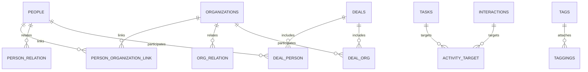

# App domain model

Core product objects are Person, Organization, Deal, Task, Activity and Tag. Activity is currently stored as `interaction` and often shown as a note; [[open-discrepancies]] X42 tracks that rename. [[link-map]] is the source for allowed links and variables.

`person_organization_link` is the storage key. **Person–Organization link** is the product term.

## Representation rules

- A Person–Organization link is the source of a person's organization connection. `people.company` is a current duplicate tracked in [[open-discrepancies]] X41.
- A deal's `OrgID` is a derived view of its primary Deal–Organization link. Task and Activity target ID lists are derived views of their activity-target links.
- A person's title and a Person–Organization link's role are separate facts. Do not copy one into the other ([[open-discrepancies]] X44).
- CSV and vCard fields are boundary translations. They map into the model and do not become core fields.
