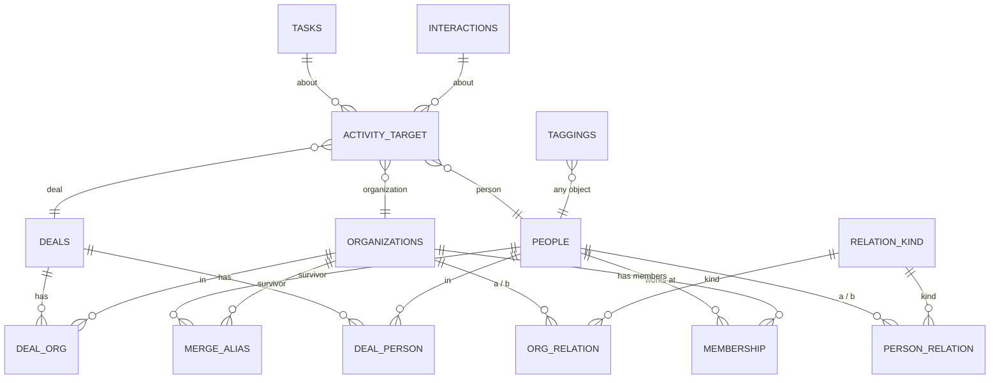

# Schema proposal: relationships that match the real world

Date 2026-10-16. Decisions Q15 to Q27 are applied. Evidence: `research-relationship-models.md`, [[research-hubspot-export]], audit of a copy of personal.db (4,446 people, 0 orgs, 0 deals, 2,266 people with company text). No migration code is written until the owner approves this note.

Patterns this serves: [[objects-first]], [[link-from-either-side]], [[one-verb-set]], [[soft-delete-restorable]], [[sync-safe-data]], [[person-belongs-to-many-organizations]], [[organizations-have-many-parents]], [[relation-kinds-have-inverses]], [[activities-attach-to-any-object]], [[hidden-not-removed-links]], [[merge-repoints-links]], [[roles-are-free-text]], [[current-membership-is-open-ended]].

## Diagram

## Rules every table follows

- Columns: `id`, `uuid`, `created_at`, `updated_at` (bumped on every change), `deleted_at` (soft delete). Purge writes a tombstone. Field-level versions apply to link attributes. ([[sync-safe-data]])
- A link is stored once and shown from both ends with the right label ([[link-from-either-side]]).
- Deleting an object hides its links. Restoring it brings them back. Purge removes them ([[soft-delete-restorable]]).

## Tables

### membership (person to organization, many to many)
`person_id` FK, `org_id` FK, `role` text (free text with suggestions), `started_on`, `ended_on` (null means current), `is_primary`, `notes`.
- At most one primary per person among live rows: partial unique index on `person_id` where `is_primary = 1 and deleted_at is null`.
- The same person and org may appear twice at different dates (rehired). Overlap is allowed.
- A person with no membership is valid. `people.title` stays as the headline job title. `people.company` stays as text until the conversion pass retires it.

### relation_kind (shared vocabulary)
`object_type` (`person` or `organization`), `name`, `inverse_name`, `symmetric`, `builtin`.
- A row `(a, b, kind)` reads "a is `name` of b" and, from b, "b is `inverse_name` of a". Symmetric kinds have `name = inverse_name` and store the pair once with the lower id first.
- Person seeds: related (symmetric, the default, equals Dex Related), spouse or partner, sibling, friend, colleague (symmetric). Parent/child, manager/report, mentor/mentee, referred-by/referred (directional). Users add kinds, symmetric or with a named inverse.
- Organization seeds: parent/child. The column is ready for partner, client, vendor and sibling later (HubSpot has sibling and partner).

### person_relation and org_relation
`a_id`, `b_id`, `kind_id` FK, `notes`. Two tables so both ends keep real foreign keys. Unique on `(a_id, b_id, kind_id)`, `a_id <> b_id`.
- `org_relation` of kind parent rejects any link that would make an organization its own ancestor. An organization may have several parents and several children.
- Person links never depend on a shared organization.

### deal_person and deal_org
- `deals.stage` is a value of the user-managed `deal_stage` vocabulary, each stage has an outcome (open, won or lost) that decides the close date, see [[deal-stages]].
- `deal_person(deal_id, person_id, role)`. The role is a deal role, a value of the user-managed `deal_role` vocabulary (champion, decision maker, economic buyer ...), see [[deal-roles]]. Text from before the vocabulary is kept as written.
- `deal_org(deal_id, org_id, is_primary, role)`. One primary among live rows per deal.

### activity_target (tasks and interactions to anything)
`source_kind` (`task` or `interaction`), `source_id`, `target_kind` (`person`, `organization`, `deal`), `target_id`, `role`.
- Replaces `task_people`, `interaction_people`, `tasks.person_id`, `tasks.deal_id`.
- Foreign keys cannot be declared on the polymorphic columns. Protect integrity with delete triggers and a `crm doctor` orphan check.
- Notes and meetings can attach to organizations and deals as well as people ([[research-hubspot-export]] H7).

### merge_alias
`kind`, `old_id`, `old_uuid`, `survivor_id`, `merged_at`. Old references and imported ids keep resolving. `people.merged_into` stays for archived duplicates.

### Tags
`taggings` already attaches to any object and keeps working.

### organizations (native fields, migration 009, schema head 9)
`website`, `size` (free text, suggested buckets 1-10, 11-50, 51-200, 201-500, 501-1000, 1001-5000, 5000+), `city`, `region`, `country`, `linkedin_url`, `description`, `logo_path` (a path only, nothing draws it, see M16). All optional text next to `name`, `domain`, `industry`, `notes`, `summary`. Pattern [[core-objects-carry-native-fields]].

## Removed
`people.org_id`, `deals.person_id`, `deals.org_id`, `tasks.person_id`, `tasks.deal_id`, tables `relationships`, `task_people`, `interaction_people`. Data moves first, then columns drop.

## Migration (one migration for the real database)
The real database is at schema 6. After the calendar code is archived and its migrations removed, task tags become migration 007 and this schema is migration 008. Your real database crosses a single step. Backup first, as for earlier upgrades.

| From | To | Real rows today |
|---|---|---|
| people.org_id | membership (primary) | 0 |
| deals.person_id, deals.org_id | deal_person, deal_org | 0 |
| tasks.person_id, task_people | activity_target | 1 |
| interaction_people | activity_target | 465 |
| relationships | person_relation | 0 |
| custom field `related_contacts` (Dex) | person_relation, kind related | 99 rows, resolved through `dex_id` |
| people.company, people.title | unchanged | 2,266 |

## Registry impact
`model.Relations` becomes a richer spec: storage table, attributes (role, dates, primary), cardinality, labels and inverse labels. CLI, MCP and TUI keep reading it, so `Link` and `Unlink` stay one verb. Attributes appear in the link form: role, dates and primary for memberships, kind for person and org links, role for deal links.

## Company-text conversion (Q21)
Changed by the owner 2026-10-27: company text creates or reuses an organization automatically at every door, with a backfill for existing people ([[convert-text-to-records-in-review-passes]]). `people.company` stays the source text. Junk strings are held in table `company_ignore` (migration 010, schema head 10: uuid, key, text, mode add or remove, timestamps). The review screen, the `org-review` tag and the `orgconvert.*` meta keys are gone.

## Out of scope here LinkedIn (M10). HubSpot and other import adapters.

## Assumptions to confirm
- E1. Two relation tables (person, organization) instead of one generic table, to keep foreign keys.
- E2. One `activity_target` table for tasks and interactions, with orphan protection by triggers and `crm doctor`.
- E3. Overlapping memberships and repeated membership at one org are allowed.
- E4. A person's primary membership drives the vCard ORG field in DAV sync. Decided: outbound ORG is the primary organization name. Inbound, an ORG that differs from it is matched to an existing organization by name (normalized name, also through merge_alias) and the primary membership is repointed in place, keeping role and dates, or created when the person has none. No match creates the organization and repoints or creates the primary membership (owner 2026-10-27, replaces Q21's review queue), and people.company gets the phone's text. A junk text (ignore list) creates nothing. Emptying ORG on the phone never removes a membership. When both sides changed ORG since the last sync the existing last-write-wins conflict path decides.
